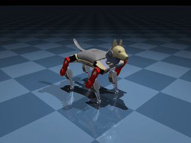
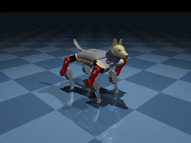
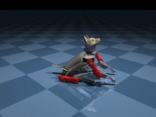

# Gemini 4 Argon × MuJoCo による四足歩行ロボット (Petoi Bittle) の制御

Gemini 4 Argon と MuJoCo を組み合わせ、自然言語で四足歩行ロボット Petoi Bittle を制御する実験プロジェクトです。[MarcHesse/bittle-mujoco](https://github.com/MarcHesse/bittle-mujoco) の物理シミュレーションモデルを利用し、動作の生成・実行・確認からスキルの保存と再利用までを扱います。

## 概要

[解説ノートブック](./bittle_gemini_walkthrough.ipynb) では、次の3つのアプローチを段階的に実装します。

| パート | アプローチ | 内容 |
| --- | --- | --- |
| Part 1 | プリセット動作による制御 | OpenCat の歩容や姿勢を Gemini の Function Calling で組み合わせ、前進・旋回・伏せなどを実行します。 |
| Part 2 | 直接関節制御 | プリセットを使わず、8関節の角度、キーフレーム補間、CPG (中枢パターン生成器) によって新しい姿勢や周期運動を合成します。 |
| Part 3 | スキルの蓄積と再利用 | 姿勢・キーフレーム列・CPG パラメータを名前付きスキルとして JSON に保存し、次回以降の指示で再利用します。 |

Gemini がツールを呼び出してシミュレーションを進め、レンダリング画像をもとに動作を確認します。実行結果は動画として保存できます。ノートブックには、二足立ちや前足を振る動作、保存済みスキルを組み合わせた二足歩行を試す例も含まれます。

ここでの「学習」は、モデルの再訓練ではなく、生成した動作パラメータを保存・再利用する仕組みを指します。

## ファイル構成

- [bittle_gemini_walkthrough.ipynb](./bittle_gemini_walkthrough.ipynb): 共通セットアップ、各方式の実装解説、実行例と結果の表示。
- [src/bittle_gemini_control.py](./src/bittle_gemini_control.py): プリセット動作を利用する制御スクリプト。
- [src/bittle_gemini_direct.py](./src/bittle_gemini_direct.py): プリセットを利用しない直接関節制御スクリプト。
- [src/bittle_gemini_skills.py](./src/bittle_gemini_skills.py): スキルの保存・読み込み・再利用を行うスクリプト。
- [videos/](./videos/): 生成したシミュレーション動画の保存先。

スキル保存用の `learned_skills.json` は動画とは別に管理します。ノートブックのスキル学習例では、別の `notebook_learned_skills.json` を使用します。

### 実行結果のサンプル

| プリセット方式での二足立ち ❌ | 保存済みスキルによる二足立ちと前足を振る動作 🟢 | 保存済みスキルを利用した二足歩行 🟢 |
| :---: | :---: | :---: |
|  |  |  |

## 実行準備

Git、[uv](https://docs.astral.sh/uv/getting-started/installation/)、MuJoCo のレンダリングが利用できる環境、および Gemini API へのアクセスが必要です。ノートブックを実行する場合は、VS Code の Python / Jupyter 拡張機能も準備してください。

1. uv を未導入の場合は、上記の公式インストール手順に従って導入します。以降のコマンドは、このリポジトリのルートで実行してください。

2. uv で Python 環境と依存ライブラリを準備します。

   ```bash
   uv python install 3.12
   uv sync --locked --no-install-project
   ```

   [.python-version](./.python-version) で指定した Python 3.12 を使用し、[pyproject.toml](./pyproject.toml) と [uv.lock](./uv.lock) に基づいて `.venv` を構築します。各制御スクリプトを直接実行する構成のため、`--no-install-project` でプロジェクト自身のパッケージ化を省略します。

3. [MarcHesse/bittle-mujoco](https://github.com/MarcHesse/bittle-mujoco) をリポジトリ直下にクローンします。

   ```bash
   git clone https://github.com/MarcHesse/bittle-mujoco.git bittle-mujoco
   ```

   `bittle-mujoco/bittle.xml` と `bittle-mujoco/gaits.py` を使用します。すでにクローン済みの場合は、この手順を省略してください。

4. リポジトリ直下の `.env` に API キーを設定します。API キーは Git にコミットしないでください。

   ```dotenv
   GEMINI_API_KEY=your_api_key
   ```

5. VS Code でリポジトリのルートを開き、[ノートブック](./bittle_gemini_walkthrough.ipynb) のカーネルに `.venv/bin/python` (Windows は `.venv/Scripts/python.exe`) を選択します。作業ディレクトリをリポジトリ直下にして、共通セットアップから順にセルを実行してください。

モデル ID はノートブックでは `gemini-4-argon` を使用しています。利用可能なモデル ID とアクセス権を確認し、必要に応じてノートブックの `model_name` またはスクリプトの `--model` で変更してください。

## コマンドラインでの実行例

リポジトリ直下から実行します。動画は既定で [videos/](./videos/) に保存され、保存先ディレクトリは自動作成されます。`--video` で別の保存先を指定することもできます。

環境構築後は `uv run --no-sync` で準備済みの `.venv` を使用できます。依存関係を変更した場合は、先に `uv sync --locked --no-install-project` を再実行してください。

```bash
# プリセット動作を組み合わせる
uv run --no-sync python src/bittle_gemini_control.py --model gemini-4-argon --prompt "前に3歩進んでから伏せて" --video videos/preset_demo.mp4

# 関節角度から動作を合成する
uv run --no-sync python src/bittle_gemini_direct.py --model gemini-4-argon --prompt "お座りして右前足を3回振って" --video videos/direct_demo.mp4

# スキルを保存し、以後の実行で再利用する
uv run --no-sync python src/bittle_gemini_skills.py --model gemini-4-argon --prompt "お座りして右前足を3回振って" --skills-file learned_skills.json --video videos/skills_demo.mp4
```

## 注意事項

- 対象は MuJoCo 上のシミュレーションであり、実機への接続や制御は含みません。
- 生成された動作の成功や安定性は保証されません。動画やシミュレーション状態で結果を確認してください。
- Gemini API の利用には、利用条件に応じた料金が発生する場合があります。
- シミュレーションの画像や指示は Gemini API に送信されます。機密情報を含めないでください。
